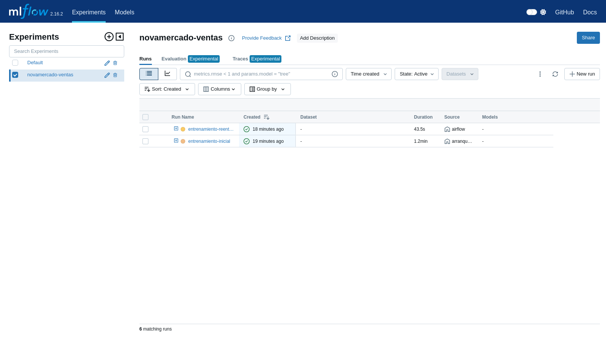
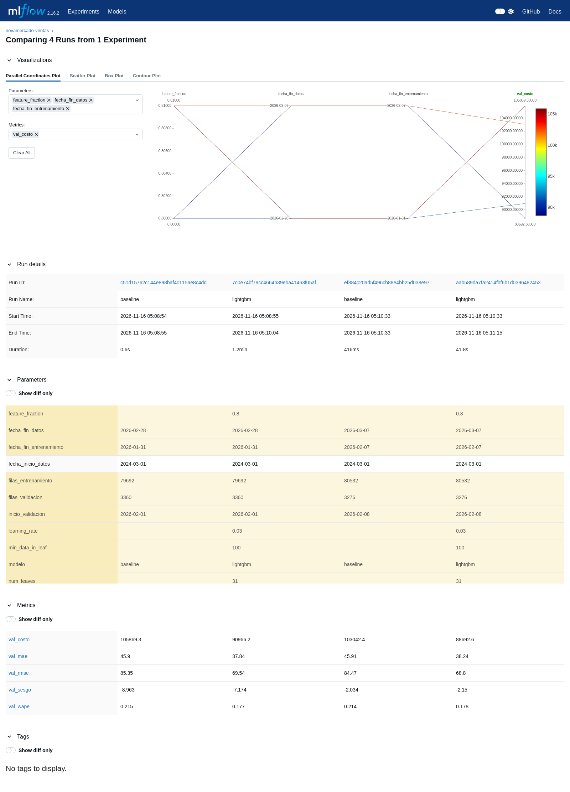
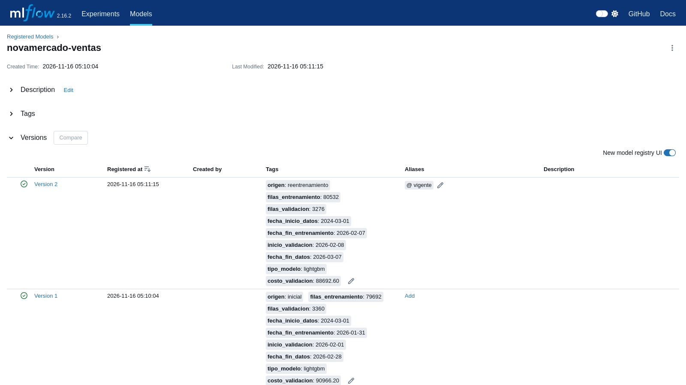
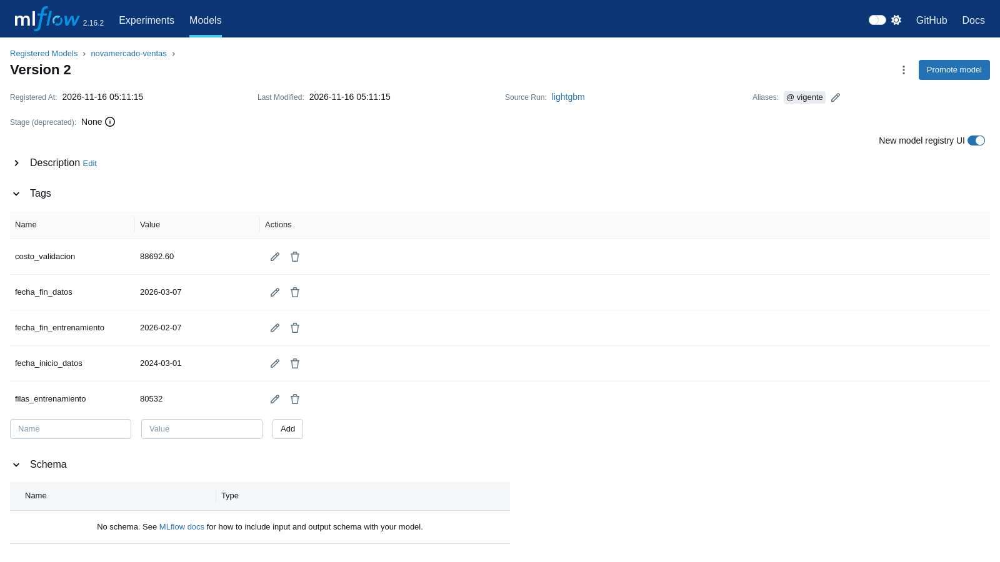
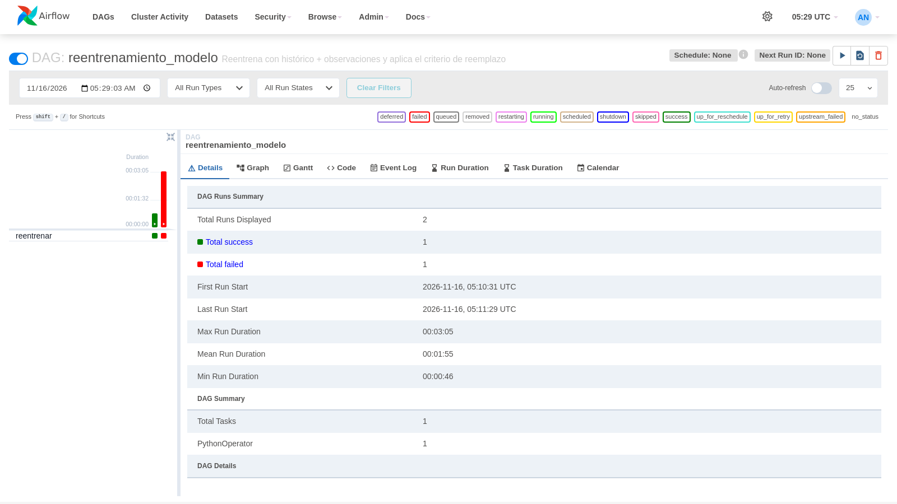
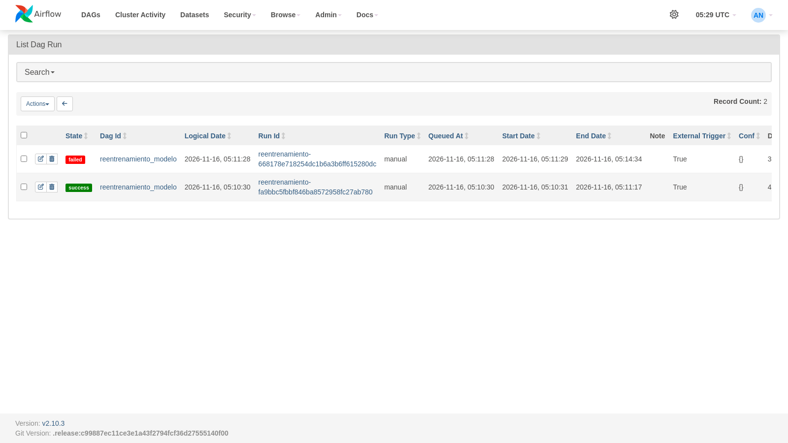

# Evidencia de funcionamiento

Generada levantando el producto desde cero (`docker compose down -v` + `docker compose up -d`) y
operándolo contra sus endpoints.

| Archivo | Contenido |
|---|---|
| [api_respuestas.md](api_respuestas.md) | Respuestas de la API ante solicitudes válidas, corregidas, con advertencia y rechazadas (incluye problemas fuera del catálogo) |
| [operacion.md](operacion.md) | Una semana simulada de operación, reentrenamiento con promoción, interrupción de MLflow, reentrenamiento fallido, reinicio sin borrar volúmenes y arranque desde cero |
| [mlflow.md](mlflow.md) | Experimento, runs (baseline y LightGBM) con métricas técnicas y de costo, versiones del modelo y alias `vigente` |
| [airflow.md](airflow.md) | Ejecuciones del DAG `reentrenamiento_modelo` (exitosa y fallida) |
| [capturas/](capturas/) | Capturas de pantalla de MLflow y Airflow (ver abajo) |

Las mismas ejecuciones pueden verse en las interfaces web mientras el producto está levantado:
MLflow en http://localhost:5000 y Airflow en http://localhost:8080 (usuario y contraseña de `.env`).

## Capturas de pantalla

Tomadas de las interfaces web al terminar la operación descrita en [operacion.md](operacion.md).

**MLflow: experimento `novamercado-ventas`.** Entrenamiento inicial (servicio de arranque) y
reentrenamiento (Airflow), cada uno con sus runs anidados.

**MLflow: comparación de los runs.** Baseline y LightGBM de ambos entrenamientos, con parámetros,
métricas técnicas (`val_mae`, `val_rmse`, `val_wape`, `val_sesgo`) y la métrica de negocio (`val_costo`).

**MLflow: Model Registry.** Versiones del modelo `novamercado-ventas` con su linaje en tags, y el
alias `vigente` en la versión 2.

**MLflow: versión vigente.** La versión 2 tiene el alias `vigente` y su run de origen es `lightgbm`.

**Airflow: DAG `reentrenamiento_modelo`.** Resumen con una ejecución exitosa y una fallida (MLflow
detenido).

**Airflow: ejecuciones del DAG.** Cada `Run Id` es el `id` que devolvió `POST /admin/reentrenar`.

Nota sobre la simulación: no hay ventas reales posteriores al histórico, así que en
[operacion.md](operacion.md) se usan como ventas "reales" las del mismo día de la semana del año anterior.
